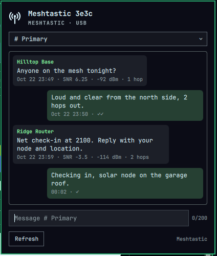

# Mesh Chat

Send and receive Meshtastic or MeshCore text messages from the Omarchy bar.



- Channel and direct-message conversations, with delivery ticks (✓ sent, ✓✓ acknowledged, ✗ failed)
- SNR, RSSI and hop count on received messages
- List of heard nodes; click one to message it directly
- Desktop notifications and an unread dot on the bar icon
- Works over USB serial, TCP/Wi-Fi or Bluetooth LE
- One radio shared by every monitor's bar

## Requirements

- Omarchy with the Quattro shell
- A Meshtastic or MeshCore radio (tested with a Heltec running Meshtastic over USB)
- Python 3 with `venv` (included in Omarchy)
- Python packages `meshtastic` and `meshcore`, installed by the setup step below into a
  private venv. Both pull in their own dependencies (`pyserial`, `bleak`, `protobuf`, …).

## Install

```bash
omarchy plugin add https://github.com/KI6UIT/omarchy-mesh-chat.git --enable
```

Then:

1. Click the radio icon in the bar and choose **Install libraries**, or run
   `~/.config/omarchy/plugins/io.github.f0tia.mesh-chat/bin/mesh-setup`.
   This creates `~/.local/share/omarchy-mesh/venv` and installs the Python packages there.
   It never uses sudo and doesn't touch system Python.
2. For USB radios, add yourself to the `uucp` group, then **log out and back in**:
   ```bash
   sudo usermod -aG uucp $USER
   ```
   Without this, opening the radio fails with `Permission denied`.
3. Plug in the radio. A single USB radio is found automatically. For anything else, open the
   widget's settings:

   | Setting | Values |
   |---|---|
   | Protocol | `meshtastic` or `meshcore` |
   | Connection | `serial`, `tcp` or `ble` |
   | Address | Serial device (blank = auto-detect), `host` for Meshtastic TCP (port 4403), `host:port` for MeshCore TCP (default 5000), or a BLE MAC address (pair it in the Bluetooth panel first) |
   | Notify on new messages | on / off |

Make sure the radio uses a USB **data** cable. Charge-only cables power the board but the
computer never sees it.

## Remove

```bash
omarchy plugin remove io.github.f0tia.mesh-chat
rm -rf ~/.local/share/omarchy-mesh   # Python venv
rm -rf ~/.local/state/omarchy-mesh   # message history and daemon log
```

Optionally take yourself out of the `uucp` group with `sudo gpasswd -d $USER uucp`.

## How it works

```
bar (monitor 1) ── meshbridge.py attach ─┐
                                         ├─ unix socket ── meshbridge.py serve ── radio
bar (monitor 2) ── meshbridge.py attach ─┘   $XDG_RUNTIME_DIR/omarchy-mesh.sock
```

A serial port can only be opened once, but every monitor runs its own bar. So a single
daemon (`serve`) owns the radio, reconnects every 10 s when it drops, and fans events out
to each bar's `attach` proxy. It exits 15 s after the last bar detaches.

Files it writes:

- `~/.local/share/omarchy-mesh/venv`: Python packages
- `~/.local/state/omarchy-mesh/<protocol>.jsonl`: message history (last 500 messages)
- `~/.local/state/omarchy-mesh/daemon.log`: daemon output, useful when reporting issues

It doesn't modify your Omarchy or radio configuration.

## IPC

```bash
qs ipc -c /usr/share/omarchy/shell call io.github.f0tia.mesh-chat toggle
qs ipc -c /usr/share/omarchy/shell call io.github.f0tia.mesh-chat status
qs ipc -c /usr/share/omarchy/shell call io.github.f0tia.mesh-chat send ch:0 "Net check-in"
```

## License

MIT, see [LICENSE](LICENSE).
